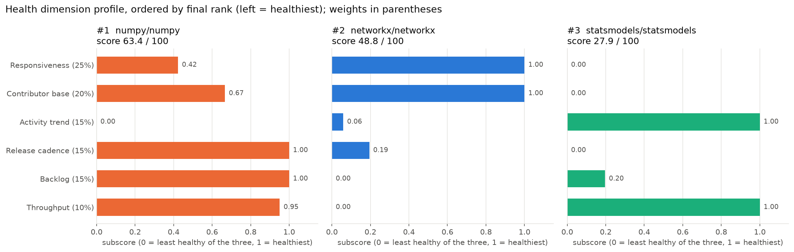
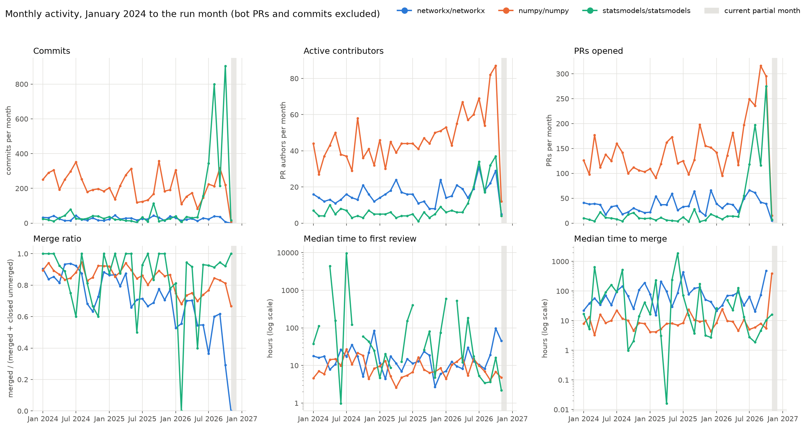
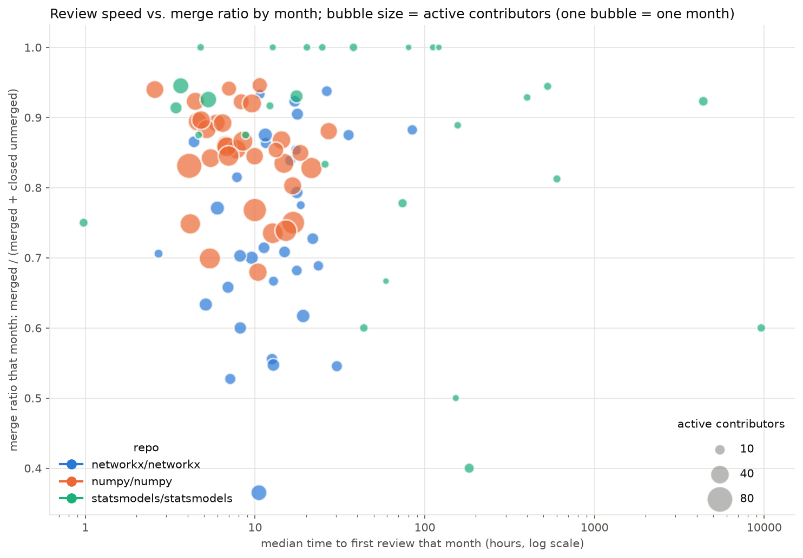

# Open Source Package Health: GitHub Data Pipeline

This project is pulling data from three different GitHub repositories, each for a Python package.
It will be using package set A, which will include numpy, networkx, and statsmodels. It will be pulling these repositories
page by page, and comparing various metrics. The analysis window of the pages pulled will start from the beginning of
2024 and continue to the present.

## Pipeline overview

The first Prefect task will be extracting commits, pull requests, PR reviews, and releases in pages of 100, using the API on
GitHub to pull these individual pages. It will utilize error handling, retries and resuming, logging, and checkpointing.
The second task will be loading this data into DuckDB tables, formatting them, allowing for SQL queries, establishing keys.
The third task will be turning these loaded tables into a real build with staging models, marts, facts, and tests to make
sure that each of these steps is correct and data isn't facing crucial flaws like missing data or duplicates. The fourth
task will be validating the full data stream and its outputs utilizing Python. The fifth task will be the final model, 
providing health scores and ranking the various repositories based on these scores, relative to each other. The sixth task will
be plotting these metrics generated for comparison and easier visualization. The flow itself lives in main.py while each
individual task is in its own file under the pipeline folder, dbt is under the models folder, outputs in the plots folder, 
and log files per task being in the logs folder.

## Setup

To create an environment that will properly run this pipeline, you should be using Python 3.12, create a virtual environment
using `uv venv` and install dependencies from `requirements.txt`. Set the GitHub personal access token to the environment
variable name GH_PAT. The token is only read from the environment itself and is never written to the repository or the logs themselves.

Setup commands
```
uv venv --python 3.12
source .venv/bin/activate
uv pip install -r requirements.txt
export GH_PAT=<your token>
```

## Running the flow


The flow can be run by executing the command `python main.py` or `time python main.py` to include the time metrics for
running the flow itself on top of the outputs the pipeline already provides. This runs one Prefect flow with all 6
tasks in order (extract, load, dbt build, validate, model, and plot), and if any task fails, the flow stops. By
default, pull requests and reviews are fetched with GraphQL (see Extended items), so the expected runtime for the first
full run is about 3.5 minutes (214 API requests, about 2.5 minutes of that in task 1). With the original REST version
(`package_health_flow(pr_source="rest")`), the first full run is a little over an hour (about 65 minutes or so, but it
can slightly vary depending on when the flow is run during the cycle of rate-limit resets of the hour and such). Almost
all of that is task 1, since it makes about 7,950 API requests, which is more than the 5,000 per hour limit, so it
sleeps for about 20 minutes partway through depending on when you start the flow. The other five tasks take under a
minute combined. Later runs are incremental and only take about 30-60 seconds since they only fetch what changed since
the last run. If a run gets interrupted, running it again
just resumes and skips the pages already saved. Task 1 writes to the `data/raw` folder and later tasks will write to
`packages.duckdb` and the `plots/` folder, and all tasks log to the `logs/` folder. Logs and runs also show up in the
Prefect UI if `PREFECT_API_URL` points to an actual Prefect server.

## Task 1: Extract

Task 1 uses 4 endpoints for each repo. The first endpoint is the commits, then the pulls, then pull request (PR) reviews, 
and then releases.
Commits are limited to the start of 2024 with `since=2024-01-01`, pull requests don't have a date filter, and are as such
sorted by most recently updated with paging stopping once a given page ends with a pull request updated before the window start (2024-01-01). Reviews are
pulled for every pull request created in that window whether or not it was actually merged. Releases are fetched in their entirety.
It uses the link header with rel="next" and
limits to 100 entries per page, saving each page as its own JSON file, which is then stored in
`data/raw/<owner_name>__<repo>/<endpoint>/page_<pg_number>.json`. Reviews
specifically are stored in `pr_reviews/pr_<number>_page_<pg_number>.json`. Record counts per endpoint per repo are logged
to the Prefect logger and `logs/extract.log`. For addressing the rate limit of a GitHub
account, the flow reads the response headers that show how many requests are left and when the limit resets
(`X-RateLimit-Remaining` and `X-RateLimit-Reset`, respectively) on every response. The flow will sleep when it reaches 10 or less requests remaining,
and then it will continue from there when the rate limit is reset. For other rate limits like 403/429, it waits the number
of seconds in the `Retry-After` header before retrying once again. For 5xx and network errors, Prefect retries the task up to 5 times
with a base backoff of 10 seconds, doubling with each retry. Other errors, such as a bad token or a 404, fail immediately, since
retrying wouldn't really help or do much for these. For resumability, pages that are already saved on the disk
are skipped, so the saved `next_url` will provide a checkpoint where to continue from in the case of interruptions and/or
errors. Pages are written to a temp (.tmp) file before being renamed so a crash never leaves pages unfinished.

Everything above describes the REST version, which still exists in the code and runs when called with `pr_source="rest"`,
but by default, the flow now uses GraphQL to fetch pull requests and reviews rather than REST. Commits and releases still
continue to use REST with the same pagination, rate limit, retry, and resume handling. The record counts and the
interrupted/resumed run below are from the REST version.

### Record counts

| Repo | Commits | Pull requests | Reviews (PRs reviewed-for) | Releases |
| --- | --- | --- | --- | --- |
| numpy/numpy | 7,693 | 5,800 | 10,557 (5,477) | 149 |
| networkx/networkx | 898 | 1,400 | 4,168 (1,275) | 67 |
| statsmodels/statsmodels | 2,797 | 1,100 | 788 (994) | 32 |

### Interrupted and resumed run

I canceled/interrupted the run by pressing ctrl+c during the numpy review calls after about 300 pages had been saved.

Interrupted run:
```
16:44:03 | INFO  | No data/raw/: first run, fetching the full window
16:44:51 | INFO  | numpy/numpy commits: 7693 records, 77 pages fetched, 0 pages already on disk
16:46:04 | INFO  | numpy/numpy pulls: 5800 records, 58 pages fetched, 0 pages already on disk
16:46:05 | INFO  | numpy/numpy pr_reviews: 5477 PRs need reviews
16:47:30 | INFO  | numpy/numpy pr_reviews: 250/5477 PRs done
^C
16:47:51 | ERROR | Task run 'extract_reviews-544' - Crash detected! Execution was aborted by an interrupt signal.
```

Resumed run:
```
16:48:49 | INFO    | No _LOADED marker: resuming, pages already in data/raw/ will be skipped
16:48:50 | INFO    | numpy/numpy commits: 7693 records, 0 pages fetched, 77 pages already on disk
16:48:51 | INFO    | numpy/numpy pulls: 5800 records, 0 pages fetched, 58 pages already on disk
17:09:27 | WARNING | 10 requests left in this hour; sleeping 1307s until reset
17:36:35 | INFO    | numpy/numpy pr_reviews: 10557 records, 5166 pages fetched, 312 pages already on disk
17:50:02 | INFO    | Extract finished: 7501 API requests this run
```

### GraphQL resume

I also tested resuming with the GraphQL version. I killed the run about 70 seconds in, after 15 of numpy's 59 GraphQL pull
request pages were saved, and no half-written files were left over. The next run skipped the pages already saved and
continued numpy from the cursor saved in page 15, so it only needed 48 requests. The final row counts matched a fresh full
run exactly. With concurrent fetching, interrupting the script/flow with ctrl+c stops the main task, but a repo thread
already running finishes the current step it's on before the program actually exits, so it can take an extra minute or 2
to actually fully stop.

```
No _LOADED marker: resuming, pages already in data/raw/ will be skipped
networkx/networkx pulls + pr_reviews (GraphQL): 1500 PRs, 5011 reviews, 0 queries, 15 pages already on disk
numpy/numpy commits: 7736 records, 0 pages fetched, 78 pages already on disk
numpy/numpy pulls + pr_reviews (GraphQL): 5900 PRs, 12785 reviews, 44 queries, 15 pages already on disk
API odometer: 48 requests this flow run (REST 2, GraphQL 46, GraphQL points 46; 46 pages saved)
```

### Rate limit and request counts

The resumed run hit the 5000 requests limit for the hour and slept until the reset. (This is shown in the warning above).
Following this sleep, it then resumed right where it left off until it finished the full flow.

| Run | API requests | Runtime |
| --- | --- | --- |
| Interrupted run | ~447 | 3m 52s |
| Resumed run | 7,501 | 61m 16s |
| Full first run total | ~7,950 | ~65 min |
| Incremental run | 105 | ~38s |

## Task 2: Load

Task 2's code is in the pipeline folder under `load.py`. It also includes the `load()` task in the flow, and it runs
directly after the `extract()` task in main.py. It just reads the data from the raw folder created in task 1, not calling
the API, only reading from the outputs from task 1. It creates raw tables, one for each endpoint, and creates a single
row per record. Each table has the `repo`, `id`, `updated_at`, `fetched_at`, `source_file`, `payload`, and a primary key using the
repo and id combined, as requested in the instructions. The `id` column stores the record's natural key (sha for
commits, number for pull requests, id for reviews/releases). An issue that came up is that only pull requests have a
real `updated_at` time, so the way around this was to use committer date for commits, `submitted_at` for reviews, and
`published_at` for releases.

For loading the data itself, I used DuckDB's `read_json()` command to read all the pages for an endpoint at the same
time, turning each page into one row per record using `unnest`. I also pulled out specific fields using DuckDB's `->>`
out of the JSON and cast them as specific data types with `::BIGINT` and `::TIMESTAMP`.

For idempotency, each table is created with `CREATE TABLE IF NOT EXISTS`, preventing duplicate table creation and so
later runs can reuse the same tables. Rows are added with `INSERT OR REPLACE` so if a row already exists with the unique
identifier, it'll replace it, and otherwise the row is just inserted into the table. This ensures no duplicates will be
written.

`_load_state` stores one row per repo per endpoint with the newest `updated_at` loaded, only writing after all the
tables have loaded, and then the `_LOADED` marker is made. On following runs, task 1 sees said marker and will delete
the raw data folder since it's all in DuckDB and use the watermark to fetch only new records. If loads crash, there's no
marker, so next runs resume and reload the files.

Before inserting the data, the QUALIFY statement keeps only the newest copy of a record if the same record appears more
than once in a batch.

### Loading the same files twice (idempotency)

Row counts from running Task 2 twice on the same landed files (`logs/load.log`):

| Table | Load 1 (before → after) | Load 2 (before → after) |
| --- | --- | --- |
| `raw_commits` | 0 → 11,388 | 11,388 → 11,388 |
| `raw_pull_requests` | 0 → 8,300 | 8,300 → 8,300 |
| `raw_pr_reviews` | 0 → 15,513 | 15,513 → 15,513 |
| `raw_releases` | 0 → 248 | 248 → 248 |

### Incremental run

A 2nd full run of the flow 2 days later properly found `_LOADED`, deleted the raw files, fetched only records created or
updated since the last run using the `_load_state` watermarks, taking 38 seconds for 105 API requests compared to 65
minutes for about 7950 requests from the first run.

| Table | Records fetched | Rows before → after |
| --- | --- | --- |
| `raw_commits` | 94 | 11,388 → 11,479 |
| `raw_pull_requests` | 300 | 8,300 → 8,345 |
| `raw_pr_reviews` | 52 | 15,513 → 15,531 |
| `raw_releases` | 248 | 248 → 248 |

Fewer rows were added than records fetched because most of the pull requests already existed and were updated in place.
Releases are always fetched in full, so all 248 were replaced with no new rows. 3 commits were the watermark commits
themselves (GitHub's `since` includes the boundary time), so the upsert replaced them rather than duplicating them.

```
14:14:44 | INFO | Found _LOADED: previous data is in DuckDB, deleting data/raw/ and fetching only new records
14:14:44 | INFO | numpy/numpy: commits since 2026-10-23T19:54:06Z, pulls since 2026-10-23T20:41:59Z
14:15:15 | INFO | Extract finished: 105 API requests this run
14:15:16 | INFO | raw_pull_requests: 300 records in files, 300 unique, rows before 8300 -> after 8345
```

## Task 3: dbt models and tests

Task 3 stores its code in the models, macros, and tests folders. It runs directly from the flow in the
`pipeline/transform.py` file, uses the `dbt_build()` task in the flow directly after `load()`, and uses PrefectDbtRunner
to run the `dbt build`. Any failed models or tests raise flags/errors and fail the flow. This is the only spot that dbt
actually runs. There aren't any retries on purpose because any fails for models or tests is an actual problem that
should be investigated, not just retried. For logging, it uses dbt's own logs under `logs/dbt.log`, logging the task's
per-model/test summary into the `transform.log` file and Prefect.

The staging layer uses views and marts use tables. The views are current without any real storage and marts are read
often by the tasks after this one. Raw tables are declared as a dbt source named raw. Staging has one model per raw
table (`stg_*`), `fct_pull_requests` and `fct_releases` add the flags and durations, and `mart_repo_monthly` and
`mart_health_inputs` hold the monthly counts and the health metrics for Task 5.

The bot rule uses SQL to check if the type of user is 'Bot' or if the user's login ends in '[bot]', and if so, it
declares it as a bot. This is applied to PR authors, reviewers, and commit authors. Missing values for user do not count
as bots, and this was written once as a macro so the rule will remain constant across models and such. These bots are
excluded from the marts and first-review timing as they're automated, so using them as metrics wouldn't make much sense.
The first review also excludes the pull request author's own reviews (since it's literally them who made it).

I also added new key columns because dbt uses single column key relationships/tests and some pull request numbers exist
in multiple repos, so it uses a combination of the repo and the number. I chose this over the `dbt_utils` package, which
would add a download step to every clean run. The timezone is manually set to UTC so there are no issues with timezones
being user-specific and changing data (otherwise events near a month boundary could be counted in the wrong month), and
run time is calculated by the maximum of the `fetched_at` in the raw tables so rebuilds with no new data gives the same
results (idempotency).

Open pull requests are kept in `fct_pull_requests` setting `is_open` to true and `merged_at` and `closed_at` staying
NULL because they're still actively being worked on. They're never dropped or given a fake close date, so
`hours_to_merge` and `hours_to_close` are NULL for them too. I used medians rather than means because the durations are
right-skewed (some pull requests have been open for years which pulls the mean way up above the typical pull request).
Since median skips NULL values, open pull requests drop out of the time-to-merge median and unreviewed ones drop out of
the time-to-first-review median, so they are instead addressed in `pct_open_stale` (open PRs) and
`pct_reviewed_within_7d` (unreviewed PRs count as not reviewed).

There are 24 tests, ultimately boiling down to a few simple things: checking for unique and non-null values in
identifier columns, checking that each review actually belongs to a pull request stored (`relationships`), checking
that pull requests and reviews have accepted values for their state (open, closed, etc.), and singular tests that are
more unique to the situation. The singular tests check that a pull request wasn't closed/merged before it was created
(since this is impossible) and that no review was submitted before the pull request was created (also impossible).
Each of these tests return the rows that don't pass said test, so passing the test means it returns zero rows.

### dbt build results

Latest flow run (`logs/transform.log` and dbt's summary line from `logs/dbt.log`), 8 models and 24 tests:

```
PASS    test  relationships_stg_pr_reviews_pr_key__pr_key__ref_stg_pull_requests_
PASS    test  assert_pr_closed_after_created
PASS    test  assert_review_after_pr_created
Done. PASS=32 WARN=0 ERROR=0 SKIP=0 NO-OP=0 REUSED=0 TOTAL=32
```

## Task 4: Validation

Task 4's code is stored in the `validate.py` file within the `pipeline` folder and the `validate()` task, running
directly after `dbt_build()` in `main.py`. It uses plain Python and SQL queries on `packages.duckdb` and reads the
landed JSON files in `data/raw/`, not running dbt at all. It logs to Prefect and the `validate.log` file under the
`logs` folder. Completeness failures raise errors and fail the flow entirely. All failures are first collected and
marked so one run shows all the problems at once. Outliers and stats don't raise errors as they are simply information.

I was going to have the connection be read-only for this task, but the dbt connection from task 3 makes it so the
connection is kept open for the same file in the Python process and DuckDB won't allow a second connection be made in
the same process with differing settings. The task just runs SELECT statements, so it's not altering the data in any
way, but it isn't just in read-only mode for the aforementioned reason.

Task 4 is unique in that it is checking the entire pipeline and describing the data. All the completeness checks
passed, and every distinct record (repo and id) in the landed files was checked against its raw table, and there were
no missing records for any repo/endpoint. To check the raw to staging step, we count the rows in the raw tables against
the rows in the staging. The difference must be equal to the staging drops row count, and all of them did during the
run of this. It also checks that each repo has at least one commit in every complete month (not the current month).

For detecting outliers, the cutoff for time to merge is one year after opening. It's the same rule for each repo as it
is a nice round number and also is a clear marker for atypical merge times since the median times were from about 5 to 61
hours, far less than an entire year. I considered a Tukey fence (Q3 + 3xIQR) for merge times too, but the times are so
right-skewed that it flagged about 12% of numpy's pull requests, which is just the normal long tail, not real outliers.
It flagged 16 pull requests: 4 in networkx, 6 in numpy, and 6 in statsmodels, ranging from just over a year (networkx #7347,
365 days) to about two and a half years (numpy #26214, 907 days). All 6 statsmodels ones were merged within the
same three weeks in August 2026.

For weekly commits, the cutoff was 3xIQR beyond the third quartile per repo. It is done per repo because a normal week
for each of these repositories is VERY different from one another (medians of 44 for numpy vs 5 for networkx). I
initially tried 1.5xIQR, but this flagged 28 weeks which was most ordinary busy weeks for given repositories, but 3xIQR
actually started marking real bursts of commits, so I stuck with that. This new rule flagged 12 weeks: 1 in networkx
(29 commits the week of July 1, 2024, against a cutoff of 23), 1 in numpy (166 commits the week of October 13, 2025,
against 152), and 10 in statsmodels, all between July and October 2026 (91 to 363 commits against a cutoff of 58). The
statsmodels weeks come from a surge of activity in mid-2026, mostly from one maintainer, and that surge also explains
its merge-time outliers: those old pull requests were finally merged during it. This surge is also what drives
statsmodels' high commit trend in Task 5.

The decided way to handle these was to keep them, not cap or drop anything, as these are real outliers for pull
requests that did eventually get merged. The percentiles and medians barely move from keeping them and dropping them
would be hiding data that is actually meaningful and demonstrate the slow behavior we're looking to judge/measure with
health metrics. Bursts of commits are very real patterns in GitHub repositories as one of the only consistent things in
a given repository is inconsistency when it comes to commits and additions, and they're real human work (bot commits
were already excluded), not data errors.

### Descriptive statistics

The descriptive statistics use medians and 90th percentiles because the durations are heavily right-skewed (the 90th
percentile is about 20 to 60 times the median). numpy responds fastest (half of its reviewed pull requests get a first review
within 7.5 hours), and statsmodels merges fastest (median 5 hours), but statsmodels' slowest 10% of reviewed pull
requests wait about 20 days for a first review. networkx is the slowest to merge (median 61 hours; the slowest 10% take about 47 days).

| Repo | Median first review | p90 first review | Median merge | p90 merge | Commits/week | Releases/year |
| --- | --- | --- | --- | --- | --- | --- |
| networkx/networkx | 12.6 h | 252.6 h | 60.9 h | 1,128.2 h | 5.9 | 4.6 |
| numpy/numpy | 7.5 h | 170.1 h | 7.8 h | 276.8 h | 49.4 | 14.8 |
| statsmodels/statsmodels | 14.5 h | 486.8 h | 5.0 h | 286.0 h | 22.2 | 2.1 |

### Evidence

From `logs/validate.log` (latest run):

```
numpy/numpy pulls: 5900 raw rows, 0 dropped on purpose, 5900 in stg_pull_requests
Commits in every complete month: checked 34 months per repo, 0 empty
All completeness checks passed
Time-to-merge outliers (merged > 8760 h = 1 year after opening): 16 PRs, kept
Weekly-commit outliers (above Q3 + 3 x IQR per repo): 12 weeks, kept
```

## Task 5: Health scoring and ranking

Task 5's code is in the `model.py` file and the `model_health()` task in the flow, running directly after `validate()`
in `main.py`. It reads the health inputs, scores, ranks, and then prints/logs to Prefect and the `model.log` file. It
then writes the ranked table it created to a table, `health_scores`, in `packages.duckdb` using SQL (CREATE OR
REPLACE). All the decisions made are within one dictionary (DIMENSIONS), providing the metric itself, its weight, and
whether it being higher or lower is healthier.

I used 6 metrics, one per dimension, which keeps it so that each subscore is just the metric's score, so each weight
maps very easily to the measurement. I decided to use `commit_trend_pct` for activity trend, `pct_reviewed_within_7d`
for responsiveness, `median_hours_to_merge` for throughput, `pct_open_stale` for backlog, `releases_per_year` for
release cadence, and `bus_factor` for contributor base. The other metrics I had before were removed from the health
inputs mart.

### Metric definitions and directions

| Dimension | Metric | Definition | Healthier when | networkx | numpy | statsmodels |
| --- | --- | --- | --- | --- | --- | --- |
| Activity (trend) | `commit_trend_pct` | Monthly commit regression slope over complete months divided by the repo's average month (% change per month) | Higher | −0.31% | −1.01% | +10.85% |
| Responsiveness | `pct_reviewed_within_7d` | Share of PRs (at least 7 days old) first reviewed by someone other than the author or a bot within a week. Never-reviewed PRs count as not reviewed | Higher | 72% | 38% | 13% |
| Throughput | `median_hours_to_merge` | Median hours from a PR being opened to being merged (merged PRs only) | Lower | 60.9 h | 7.8 h | 5.0 h |
| Backlog | `pct_open_stale` | Share of open PRs with no activity in 180 days or more | Lower | 59% | 31% | 53% |
| Release cadence | `releases_per_year` | Releases in the window divided by the window's length in years | Higher | 4.6 | 14.8 | 2.1 |
| Contributor base | `bus_factor` | Fewest PR authors who collectively account for at least half of merged PRs | Higher | 4 | 3 | 1 |

For normalization, I decided to just not use `commits_per_week` as a metric because it's a raw volume thing, so numpy
would win just by being bigger (it has about 8x networkx's commits), and `ASSESSING-HEALTH.md` ranks raw volume last
as a vanity metric, so it stays as just a stat to look at, not a metric. Each metric that is scored is scaled with
min-max scaling, putting them all on a 0 to 1 scale, so the worst gets a 0, the best gets a 1, and the middle repo gets
some scale between the two, which demonstrates the distance between each repo. All the metrics are some percentage,
median, rate, % change, or small headcount, so bigger repos won't just score high purely because they're bigger,
which is helpful here since the size of each repo varies a LOT.

For scoring, the min-max scaling is used, but also for metrics that are better when lower such as
`median_hours_to_merge` or `pct_open_stale`, it is flipped with 1 - x so the lowest value gets a score of 1 and the
highest gets a score of 0, just to keep everything when scored on the scale of higher being better for ranking/scoring.

For weights, I followed the order of importance that `ASSESSING-HEALTH.md` lists health signals in, and gave
decreasing weights down that list, as the order made sense to me and I didn't particularly see any need to change
it. Responsiveness is definitely one of, if not the, best metrics for repo health because it shows that there
are people within the repo that are active in the community AND responding to other users. Contributor base is also
good because it can show how spread out the work is (which is typically a good sign) and not just relying on one or two
people to keep it alive (so these two metrics got 25% and 20% weight, respectively). From there, the weights just
decreased as things like activity and throughput are important, but are less important than the other metrics
mentioned previously, so activity trend, release cadence, and backlog get 15% each, and throughput gets 10%.

The final score is calculated by multiplying each subscore by its weight, adding those up, and multiplying by 100 to
give it a 0-100 scale. The code makes sure the weights sum up to 1 or will flag this and not continue further as the
weights not summing to 1 would mean a repo's max score is no longer 100 and the scale is all off.

For analyzing trends, `commit_trend_pct` calculates a regression slope over the complete months from 2024 to
present, divided by the repo's average month so it's a % change and normalized to the size. There was a surge in
2026 for statsmodels, but I didn't alter it or get rid of it as this is a real mark of human work and shouldn't be
discarded or altered just because it's strange or doesn't fit a perfect pattern.

When messing with the weights, 2nd and 3rd place get very close. For example, using equal weights for each metric
gives networkx 37.6 and statsmodels 36.6, only a point apart, while the weights I used put networkx well ahead (48.8 vs 27.9)
due to the emphasis more on responsiveness and bus factor. (On an earlier run, equal weights actually swapped them, so
2nd and 3rd depend on weights and on small changes in the data.) Regardless, numpy takes 1st place in pretty much every configuration (although I'm sure
there's some configuration you could use to swap that, but the rational ones all seem to put numpy in 1st).

### Ranking

Latest run (`logs/model.log`), also written to the `health_scores` table in `packages.duckdb`. Subscores are 0-1 (1 =
healthiest of the three, before weighting), score is 0-100.

| Rank | Repo | Score | Responsiveness (25%) | Contributor base (20%) | Activity trend (15%) | Release cadence (15%) | Backlog (15%) | Throughput (10%) |
| --- | --- | --- | --- | --- | --- | --- | --- | --- |
| 1 | numpy/numpy | 63.4 | 0.42 | 0.67 | 0.00 | 1.00 | 1.00 | 0.95 |
| 2 | networkx/networkx | 48.8 | 1.00 | 1.00 | 0.06 | 0.19 | 0.00 | 0.00 |
| 3 | statsmodels/statsmodels | 27.9 | 0.00 | 0.00 | 1.00 | 0.00 | 0.20 | 1.00 |

## Task 6: Plots

Task 6's code is in `plot.py` within the pipeline and the `plot()` task. It's the last task in the flow, following
`model_health()`. It reads the health scores from the previous task and the monthly repo mart, saves 3 plots as
PNGs using matplotlib, and logs to Prefect and `plot.log` in the `logs` folder. It uses consistent colors as
requested in the rubric, networkx being blue, numpy being orange, and statsmodels being green. It assigns these colors
alphabetically so the repo's color won't change or depend on the rank or anything like that, just the name (which
obviously won't change), and uses these same colors in all 3 plots. I tried to use original units whenever possible,
but the log scale for the bubble chart's x axis and the two hours panels in the trends chart multiplies by 10x each
tick, and it still shows the tick values in just hours.



This small-multiples bar chart keeps each panel to one repo per, with the left being the healthiest and decreasing
as it moves right. The title shows the repo, rank, and overall score. It has one bar per health metric/dimension as
well as its subscore and weight displayed in the labels. Each repo has a different shape with numpy being the overall
strongest, but not simply winning in every category. You can see that networkx leads on contributor base and
responsiveness but is the worst on backlog and throughput. Statsmodels is pretty much the opposite with having the
fastest throughput and best trend, but the worst responsiveness, contributor base, and release cadence. Numpy wins
here since its only 0 is the activity trend while the other two packages have huge holes in their performance
(which could suggest smaller projects are less consistent, though with only three repos, it's mainly just a guess/assumption
more than anything).



This trends chart shows a panel per metric, with one line within each per repo. It runs from the beginning of the
window to present (Jan 2024 to current), shows the current partial month, and excludes all bot contributions. We can
quickly see statsmodels surge in 2026 very sharply, especially visible in the commits and PRs opened graphs. Numpy
grows steadily across the board on active contributors and PRs opened and shows pretty stable consistency on the
other charts. Networkx is also pretty stable across the board with the exception of merge ratio as it declines
steadily over the past couple years, starting around 0.9 and going down to about 0.5-0.7 in most of 2026, with lows
of about 0.37 in July and 0.29 in October (the current partial month, November, only has a few days so far). This again shows the potential trend that
larger repos like numpy can grow while staying steady, while statsmodels' swings come from having only a few PRs per
month.



This bubble chart plots review speed against merge ratio, including the repo as the color, active contributors as the
bubble size, and having one bubble per month within each repo (excluding the current/incomplete month). The x axis is
median hours to the first review (log scale), and the y axis is the merge ratio. This measures 4 different variables
all in one plot. Numpy's bubbles are a far more tight cluster while networkx and statsmodels spread out. Obviously,
the bubbles for numpy are also larger as it is a larger repo, and statsmodels has the smallest subset of bubbles on
average (fewest contributors active). Numpy's tight cluster shows a fast review combined with a high merge ratio
(ranging from about 0.7 to 0.95). Networkx sits lower on the graph with a similar review speed to numpy, but lower
merge ratios (even going down to about 0.3 at the lowest). Statsmodels is extremely spread out on both axes,
ranging in merge ratio from about 0.4 to 1.0, and ranging in first review time from under an hour all the way up to
about 10,000 hours. It has far fewer contributors and reviewed PRs per month, so each month's median relies on just a
few PRs and is bound to be more inconsistent and very scattered given its size. Within each repo, a faster review
doesn't clearly indicate a higher merge ratio, but the differences between each repo are very clear just looking at
the graph as previously explained.

## Extended items


I attempted all 4 extended items: GraphQL ingestion, concurrent fetching, scheduled deployment, and the API
odometer.

### GraphQL ingestion

Pull requests and reviews are fetched with GitHub's GraphQL API by default now (`fetch_pulls_graphql()` within `extract.py`).
One query returns 100 pull requests, newest updated first, showing up to 100 reviews for each one, replacing about 100 REST
review calls. It pages with cursors, stops at the window start or watermark just like the REST version does, and tracks the
5000 point hourly budget from the `rateLimit` field of each query (stopping before hitting 0). The rare pull request with
over 100 reviews gets follow-up queries to handle it. Each result is converted into the same shape as the REST records and
saved in the same folders, so task 2, the dbt models, and tests work the same. Commits and releases still use REST and the
REST version for the pull requests and reviews still works with `pr_source="rest"` as previously mentioned.

| Full first run (empty `data/` and database) | API requests | Task 1 runtime | Whole flow |
| --- | --- | --- | --- |
| REST (Oct 23) | about 7,950 | about 65 min (including a ~22 min rate-limit sleep) | about 65 min |
| GraphQL + concurrency (Nov 3) | 214 (126 REST + 88 GraphQL, 88 points) | 164 s | 3 min 34 s |

```
Extract finished (graphql for PRs/reviews): 212 pages fetched in 164s
API odometer: 214 requests this flow run (REST 126, GraphQL 88, GraphQL points 88; 212 pages saved)
```

### Concurrent fetching

The 3 repos are fetched at the same time. `extract()` submits one `extract_repo` task per repo with Prefect's
`.submit()`, so they run in parallel threads. A shared `RateLimiter` per API (REST and GraphQL) keeps the total usage
under the quota. When any thread sees the budget running low or gets rate limited, it pauses and every thread
waits for it to resume before its next request. The odometer also uses a lock so parallel threads can't miscount. In the
logs, all 3 repos start within the same second.

### Scheduled deployment

`deploy.py` registers a Prefect deployment on the SDS server (`uvasds-k8s-pool`) that runs on the 28th each month. It
clones this private repo with a Prefect "Secret" block, and the flow reads its GitHub token from said block on the server.
`DEPLOYMENTS.md` has the deploy command and the full log of a run I triggered from the UI on Prefect (finished in ~3m). The
server starts every run from an empty folder, so each scheduled run counts as a full first run.

### API odometer

I implemented it by counting each request sent to the GitHub API in a
flow run and logging the total. This is done in `extract.py` using a counter that increases by 1 within `send()`, which
is the one function that every single API call goes through (REST and GraphQL), so it doesn't need to be anywhere else. `extract()` resets it
back to 0 at the beginning of each run and logs it at the end of said run. Task 1 is the only task that calls the API, so
that number from task 1 is the entire flow's total. Every response like rate-limited, server errors, network issues, requests lost when Prefect retries a task,
etc. are all still requests to the API but don't save a page, so counting in the place that each of these things go
through is the easiest way to still keep track of them all, rather than adding up the saved pages afterward, which
would miss them. Since the repos are now fetched at the same time, the counter is updated under a lock so 2 different
threads can't update it at the same time and cause any issues. It counts REST requests, GraphQL requests, and GraphQL
points separately.

### Evidence

The two numbers match when nothing fails or retries. Any difference would be the failed or retried requests.

```
API odometer: 214 requests this flow run (REST 126, GraphQL 88, GraphQL points 88; 212 pages saved)
```

The 214 requests vs 212 pages difference is 2 GraphQL follow-up queries for PRs with over 100 reviews, whose
extra review pages are saved but not included in the pages count.
